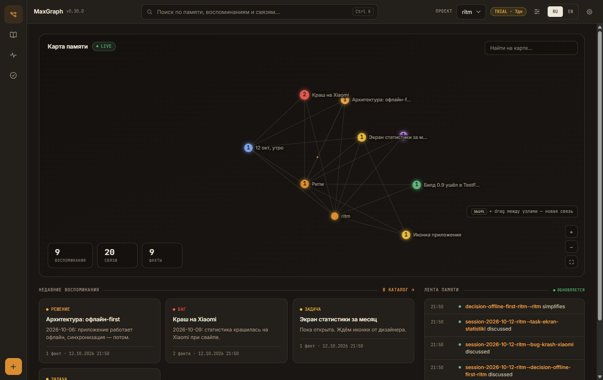

<p align="center">
  
</p>

<p align="center">
  <strong>Встроенная память помнит тебя. MaxGraph помнит все твои проекты.</strong>
</p>

<p align="center">
  <a href="https://rezon-ai.ru">Сайт</a> ·
  <a href="https://rezon-ai.ru/blog/">Блог</a> ·
  <a href="https://t.me/maxgraph_mcp">Telegram</a> ·
  <a href="#подключение-в-один-шаг">Подключение</a>
</p>

<p align="center">
  
  
  
</p>

<p align="center">
  <strong>Русский</strong> · <a href="README_EN.md">English</a>
</p>

---

Память ChatGPT и Claude помнит тебя: имя, вкусы, привычки. MaxGraph помнит твою **работу** — решения, баги, открытые задачи, итоги сессий. Ставится один раз, и контекст проекта есть у всех твоих агентов: Claude, Cursor, DeepSeek и любых других с поддержкой MCP или REST.

| Возможность | Что даёт |
|---|---|
| 🧠 **Память проекта** | Решения, баги и открытые задачи — с датами, отдельно от чата. Закрыл диалог — записи остались. |
| 🚀 **Старт без разгона** | Каждая сессия начинается с короткой выжимки по проекту: агент сразу в курсе и не делает одну работу дважды. |
| 🔍 **Семантический поиск** | Находит нужное по смыслу, а не по точным словам. |
| 👀 **Всё видно глазами** | Дашборд: карта памяти, поиск, лента. Любую запись можно проверить, поправить или удалить. |
| 🪶 **Экономия токенов** | История не перечитывается целиком — примерно −43 % токенов при работе с MaxGraph. |



## Как это работает

Ничего нового учить не придётся: работаешь с агентом как обычно, память появляется сама.

1. **Работаешь как обычно.** Агент сам записывает важное из твоей работы: решения, баги, итоги.
2. **Всё хранится локально.** Обычные текстовые файлы на твоём компьютере, интернет не нужен. Дашборд показывает каждую запись.
3. **Новая сессия — агент уже в курсе.** Он получает выжимку по проекту и продолжает с того места, где ты остановился.

Память делится на **проекты**: рабочий код, личные заметки и фриланс не смешиваются.

## Установка

Самый простой способ — попросить своего ИИ-агента. Вставь ему в чат:

> Установи MaxGraph: https://github.com/RuMemory/maxgraph — сделай всё сам по AGENTS.md. Скажи, когда память заработает.

Агент сам склонирует репозиторий, запустит установщик, подключит память и проверит, что она пишется.

Руками — одна команда (Docker не требуется):

```bash
git clone https://github.com/RuMemory/maxgraph && cd maxgraph
bash install.sh --yes       # Linux / macOS
```

```powershell
# Windows (PowerShell)
powershell -NoProfile -ExecutionPolicy Bypass -File .\install.ps1 -Yes
```

Дальше программа работает сама: иконка в трее, автозапуск с системой, автообновления.

## Подключение в один шаг

Сервер уже запущен? Дальше одна команда или одна ссылка:

- **Claude Code** — плагин из нашего маркетплейса, токен спросит при установке:
  ```
  claude plugin marketplace add RuMemory/maxgraph
  claude plugin install maxgraph@maxgraph
  ```
- **Cursor** — вставь в адресную строку браузера (после установки замени `PASTE_TOKEN_HERE` на свой токен в Settings → MCP):
  ```
  cursor://anysphere.cursor-deeplink/mcp/install?name=maxgraph&config=eyJ1cmwiOiJodHRwOi8vbG9jYWxob3N0Ojg3ODcvbWNwIiwiaGVhZGVycyI6eyJBdXRob3JpemF0aW9uIjoiQmVhcmVyIFBBU1RFX1RPS0VOX0hFUkUifX0=
  ```
- **VS Code** — вставь в адресную строку браузера (токен подставляется в settings):
  ```
  vscode:mcp/install?%7B%22name%22%3A%22maxgraph%22%2C%22type%22%3A%22http%22%2C%22url%22%3A%22http%3A%2F%2Flocalhost%3A8787%2Fmcp%22%2C%22headers%22%3A%7B%22Authorization%22%3A%22Bearer%20PASTE_TOKEN_HERE%22%7D%7D
  ```
- **Cline и другие агенты** — дай агенту файл [AGENTS.md](AGENTS.md), он поставит и подключит сам.

Подробности по каждому клиенту: [docs/PAIRING.md](docs/PAIRING.md).

## С кем работает

| Клиент | Как подключить |
|---|---|
| Claude Desktop / Claude Code | Плагин из маркетплейса, одна команда |
| Cursor / VS Code | Ссылка в один клик, выше |
| Cline / Continue | MCP streamable-http + Bearer |
| ChatGPT / OpenAI-совместимые | REST API или агент-адаптер |
| Kimi, GLM, Qwen, Hermes, DeepSeek | REST API — любой HTTP-клиент |

Готовые примеры настройки под каждый клиент: [docs/PROVIDERS.md](docs/PROVIDERS.md). Пользуешься другим агентом? Если он умеет подключать внешние инструменты, MaxGraph к нему подключится.

## Цены

7 дней бесплатно, без карты. Триал начинается с первого запуска, включать ничего не нужно. Дальше один тариф со всем включённым, разовый платёж без автосписаний:

| Срок | Цена | В месяц |
|---|---|---|
| 1 месяц | 149 ₽ | 149 ₽ |
| 3 месяца | 399 ₽ | ≈ 133 ₽ |
| 6 месяцев | 749 ₽ | ≈ 125 ₽ |
| 12 месяцев | 1 299 ₽ | ≈ 108 ₽ |

Когда триал закончится, перестанет работать только запись новых фактов. Дашборд, поиск и выгрузка остаются, накопленная память никуда не денется.

Купить и активировать: [rezon-ai.ru](https://rezon-ai.ru)

## Пригласи друга

У MaxGraph есть реферальная программа. Друг покупает со скидкой −20 %, а ты получаешь +10 % к скидке на продление за каждого приглашённого, вплоть до −50 %. Твоя ссылка и статистика переходов — в дашборде, раздел «Система».

## Приватность

Все записи хранятся только на твоём компьютере и работают офлайн. Это обычные текстовые файлы в папке `data/`: их можно открыть, прочитать и скопировать в любой момент. Из дашборда всё выгружается одним файлом (экспорт в NDJSON).

## Ссылки

- Сайт и покупка: [rezon-ai.ru](https://rezon-ai.ru)
- Блог: [rezon-ai.ru/blog](https://rezon-ai.ru/blog/) — статьи про память агентов, MCP и экономию токенов
- Telegram: [t.me/maxgraph_mcp](https://t.me/maxgraph_mcp) — новости и релизы

Документы: [PROTOCOL](docs/PROTOCOL.md) · [API](docs/API.md) · [PROVIDERS](docs/PROVIDERS.md) · [PAIRING](docs/PAIRING.md) · [DEPLOY-LAN](docs/DEPLOY-LAN.md)

## Поддержать

MaxGraph живёт на поддержку пользователей. Если проект оказался полезным, можно просто сказать спасибо: [rezon-ai.ru#donate](https://rezon-ai.ru/#donate). Разовый перевод 99, 249 или 499 ₽, без подписки и автосписаний.

## Лицензия

[BSL-1.1](LICENSE): исходный код открыт. Личное и внутреннее использование — бесплатно. Продажа MaxGraph как сервиса — по коммерческой лицензии. Каждая версия становится MIT через четыре года после публикации.

## Ключевые слова

`mcp server` `ai memory` `llm context` `knowledge graph` `persistent memory for ai agents` `model context protocol` `memory for claude code` `claude code plugin` `cursor memory` `vscode mcp` `chatgpt memory` `agent memory` `context engineering` `semantic search` `long-term memory for llm` `self-hosted ai` `память для нейросети` `память для ИИ-агентов` `MCP сервер памяти` `граф знаний` `долговременная память ИИ` `экономия токенов` `память для Claude` `память для ChatGPT` `память для Cursor` `локальная память для ИИ`

---

<p align="center">
  <strong>Установи один раз — и каждый твой агент помнит проект.</strong>
</p>
