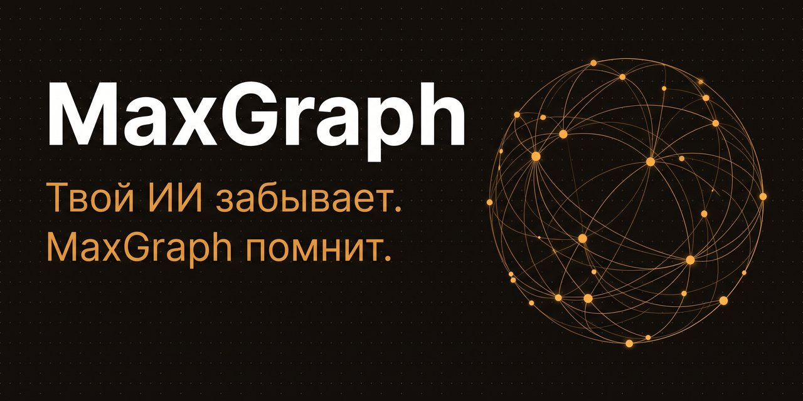

# MaxGraph

🇬🇧 [English version](README_EN.md) · Русский

   [](https://aiagentslisting.com/mcp/maxgraph)

## Хватит объяснять нейросети всё сначала

Каждая новая сессия с ИИ начинается с пустого чата: агент не помнит ни проект, ни решения, ни вчерашние договорённости. MaxGraph это исправляет. Он запоминает твой проект между сессиями, и агент начинает там, где ты закончил.

Для разработчика: это MCP-сервер с графом знаний и семантическим поиском, который поднимается в Docker за две минуты и подключается к любому агенту, умеющему работать с внешними инструментами.

🌐 [rezon-ai.ru](https://rezon-ai.ru) · Триал 7 дней, без карты · Экономия токенов примерно 43 % при работе с MaxGraph

## Как работает

Ничего нового учить не придётся. Ты работаешь с агентом как обычно, память появляется сама, в фоне.

1. Работаешь как обычно. Агент сам запоминает важное из вашей работы: решения, баги, договорённости.
2. Память лежит у тебя. Всё записанное хранится на твоей машине. Открой дашборд и проверь любой факт глазами.
3. Начинаешь новую сессию. Агент уже помнит проект и не делает одну и ту же работу дважды.

## Что ты получаешь

- Агент помнит проект между сессиями: решения, баги, задачи и договорённости, с датами.
- Записи лежат отдельно от чата. Диалог можно закрыть или удалить, записи это не заденет.
- Каждая сессия начинается с короткой выжимки по проекту. Перечитывать всю историю не нужно, отсюда и экономия токенов.
- Незаконченные дела всплывают сами, напоминать о них не нужно.
- Всё записанное видно глазами в дашборде: карта памяти, поиск, лента событий.


## С кем работает

| Клиент | Как подключить |
|---|---|
| Claude Desktop / Claude Code | Плагин из маркетплейса, одна команда |
| Cursor / VS Code | Ссылка в один клик, ниже |
| Cline / Continue | MCP streamable-http + Bearer |
| ChatGPT / OpenAI-совместимые | REST API или агент-адаптер |
| Kimi, GLM, Qwen, Hermes, DeepSeek | REST API — любой HTTP-клиент |

Готовые примеры настройки под каждый клиент: [docs/PROVIDERS.md](docs/PROVIDERS.md). Пользуешься другим агентом? Если он умеет подключать внешние инструменты, MaxGraph к нему подключится.

## Установка

Нужен только Docker:

```bash
git clone https://github.com/RuMemory/maxgraph && cd maxgraph
docker compose up -d --build
```

Нет Docker? Установщик поставит движок сам (официальный Docker Desktop с docker.com на Windows/macOS, Docker Engine на Linux): `bash install.sh` или `powershell -File install.ps1` из папки репозитория. Устанавливает ИИ-агент? Ему — [AGENTS.md](AGENTS.md).

Токен доступа генерируется сам при первом запуске, возьми его из логов:

```bash
docker compose logs maxgraph | grep "автогенерация"   # или: cat data/local_token.txt
```

Открой дашборд `http://localhost:8787/app` и введи токен. Обновления ставятся сами, раз в сутки. Не нужны — отключи: `AUTO_UPDATE=0`.

## Подключение в один шаг

Сервер уже запущен? Дальше одна команда или одна ссылка:

- **Claude Code** — плагин из нашего маркетплейса, токен спросит при установке:
  ```
  claude plugin marketplace add RuMemory/maxgraph
  claude plugin install maxgraph@maxgraph
  ```
- **Cursor** — вставь в адресную строку браузера (после установки замени `PASTE_TOKEN_HERE` на свой токен в Settings → MCP):
  ```
  cursor://anysphere.cursor-deeplink/mcp/install?name=maxgraph&config=eyJ1cmwiOiJodHRwOi8vbG9jYWxob3N0Ojg3ODcvbWNwIiwiaGVhZGVycyI6eyJBdXRob3JpemF0aW9uIjoiQmVhcmVyIFBBU1RFX1RPS0VOX0hFUkUifX0=
  ```
- **VS Code** — вставь в адресную строку браузера (токен подставляется в settings):
  ```
  vscode:mcp/install?%7B%22name%22%3A%22maxgraph%22%2C%22type%22%3A%22http%22%2C%22url%22%3A%22http%3A%2F%2Flocalhost%3A8787%2Fmcp%22%2C%22headers%22%3A%7B%22Authorization%22%3A%22Bearer%20PASTE_TOKEN_HERE%22%7D%7D
  ```
- **Cline и другие агенты** — дай агенту файл [llms-install.md](llms-install.md), он поставит и подключит сам.

Подробности по каждому клиенту: [docs/QUICKSTART.md](docs/QUICKSTART.md).

## Цены

7 дней бесплатно, без карты. Триал начинается с первого запуска, включать ничего не нужно. Дальше один тариф со всем включённым, разовый платёж без автосписаний:

| Срок | Цена | В месяц |
|---|---|---|
| 1 месяц | 149 ₽ | 149 ₽ |
| 3 месяца | 399 ₽ | ≈ 133 ₽ |
| 6 месяцев | 749 ₽ | ≈ 125 ₽ |
| 12 месяцев | 1 299 ₽ | ≈ 108 ₽ |

Когда триал закончится, перестанет работать только запись новых фактов. Дашборд, поиск и выгрузка остаются, накопленная память никуда не денется.

Купить и активировать: [rezon-ai.ru](https://rezon-ai.ru)

## Пригласи друга

У MaxGraph есть реферальная программа. Друг покупает со скидкой −20 %, а ты получаешь +10 % к скидке на продление за каждого приглашённого, вплоть до −50 %. Твоя ссылка и статистика переходов — в дашборде, раздел «Система».

## Ссылки

- Сайт и покупка: [rezon-ai.ru](https://rezon-ai.ru)
- Блог: [rezon-ai.ru/blog](https://rezon-ai.ru/blog/) — статьи про память агентов, MCP и экономию токенов
- Telegram: [t.me/maxgraph_mcp](https://t.me/maxgraph_mcp) — новости и релизы

## 💛 Поддержать

MaxGraph живёт на поддержку пользователей. Если проект оказался полезным, можно просто сказать спасибо: [rezon-ai.ru#donate](https://rezon-ai.ru/#donate). Разовый перевод 99, 249 или 499 ₽, без подписки и автосписаний.

## Приватность

Все записи хранятся только на твоём компьютере и работают офлайн. Это обычные текстовые файлы в папке `data/`: их можно открыть, прочитать и скопировать в любой момент. Из дашборда всё выгружается одним файлом (экспорт в NDJSON).

## Лицензия

[BSL-1.1](LICENSE): исходный код открыт. Личное и внутреннее использование — бесплатно. Продажа MaxGraph как сервиса — по коммерческой лицензии. Каждая версия становится MIT через четыре года после публикации.

## Документы

[QUICKSTART](docs/QUICKSTART.md) · [PROTOCOL](docs/PROTOCOL.md) · [API](docs/API.md) · [GPTs](docs/GPTS.md) · [PROVIDERS](docs/PROVIDERS.md) · [PAIRING](docs/PAIRING.md) · [DEPLOY-LAN](docs/DEPLOY-LAN.md)

## Ключевые слова

`mcp server` `ai memory` `llm context` `knowledge graph` `persistent memory for ai agents` `model context protocol` `memory for claude code` `claude code plugin` `cursor memory` `vscode mcp` `chatgpt memory` `agent memory` `context engineering` `semantic search` `long-term memory for llm` `self-hosted ai` `память для нейросети` `память для ИИ-агентов` `MCP сервер памяти` `граф знаний` `долговременная память ИИ` `экономия токенов` `память для Claude` `память для ChatGPT` `память для Cursor` `локальная память для ИИ`
