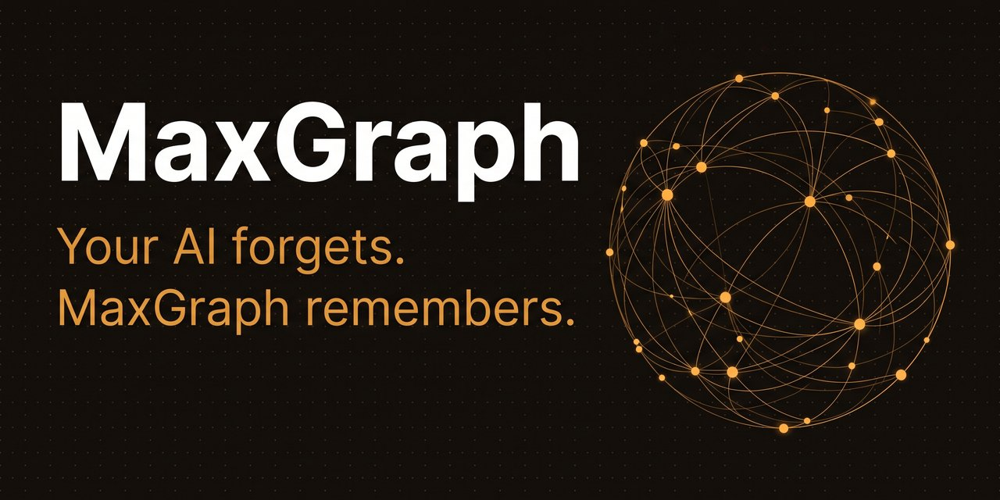

# MaxGraph

🇷🇺 [Русская версия](README.md) · English

  

## Stop explaining everything to your AI from scratch

Every new session starts with an empty chat: the agent remembers neither the project, nor the decisions, nor yesterday's agreements. MaxGraph fixes that. It remembers your project between sessions, and the agent picks up where you left off.

For developers: an MCP server with a knowledge graph and semantic search. It comes up in Docker in two minutes and connects to any agent that can use external tools.

🌐 [rezon-ai.ru](https://rezon-ai.ru) · 7-day trial, no card · Working with MaxGraph saves about 43 % of tokens

## How it works

Nothing new to learn. You work with your agent as usual, memory appears on its own, in the background.

1. Work as usual. The agent remembers the important parts of your work on its own: decisions, bugs, agreements.
2. Memory stays on your machine. Open the dashboard and check any fact with your own eyes.
3. Start a new session. The agent already remembers the project and never does the same work twice.

## What you get

- The agent remembers the project between sessions: decisions, bugs, tasks and agreements, with dates.
- Records live separately from the chat. You can close or delete the conversation, the records are untouched.
- Every session starts with a short project summary. No re-reading the whole history, which is where the token savings come from.
- Unfinished work surfaces on its own, no reminders needed.
- Everything recorded is visible in the dashboard: memory map, search, event feed.


## Works with

| Client | How to connect |
|---|---|
| Claude Desktop / Claude Code | Plugin from our marketplace, one command |
| Cursor / VS Code | One-click link, below |
| Cline / Continue | MCP streamable-http + Bearer |
| ChatGPT / OpenAI-compatible | REST API or agent adapter |
| Kimi, GLM, Qwen, Hermes, DeepSeek | REST API, any HTTP client |

Ready-made setup examples for each client: [docs/PROVIDERS.md](docs/PROVIDERS.md). Using a different agent? If it can connect external tools, MaxGraph will connect to it.

## Installation

All you need is Docker:

```bash
git clone https://github.com/RuMemory/maxgraph && cd maxgraph
docker compose up -d --build
```

No Docker? The installer sets up an engine itself (Rancher Desktop on Windows/macOS, Docker Engine on Linux): `bash install.sh` or `powershell -File install.ps1` from the repo folder. An AI agent doing the install reads [AGENTS.md](AGENTS.md).

The access token is generated on first launch, take it from the logs:

```bash
docker compose logs maxgraph | grep "автогенерация"   # or: cat data/local_token.txt
```

Open the dashboard at `http://localhost:8787/app` and enter the token. Updates install themselves once a day. Don't want them — disable with `AUTO_UPDATE=0`.

## One-step connection

Server already running? Then it's one command or one link:

- **Claude Code** — plugin from our marketplace, it will ask for the token during install:
  ```
  claude plugin marketplace add RuMemory/maxgraph
  claude plugin install maxgraph@maxgraph
  ```
- **Cursor** — paste into your browser's address bar (after install, replace `PASTE_TOKEN_HERE` with your token in Settings → MCP):
  ```
  cursor://anysphere.cursor-deeplink/mcp/install?name=maxgraph&config=eyJ1cmwiOiJodHRwOi8vbG9jYWxob3N0Ojg3ODcvbWNwIiwiaGVhZGVycyI6eyJBdXRob3JpemF0aW9uIjoiQmVhcmVyIFBBU1RFX1RPS0VOX0hFUkUifX0=
  ```
- **VS Code** — paste into your browser's address bar (the token goes into settings):
  ```
  vscode:mcp/install?%7B%22name%22%3A%22maxgraph%22%2C%22type%22%3A%22http%22%2C%22url%22%3A%22http%3A%2F%2Flocalhost%3A8787%2Fmcp%22%2C%22headers%22%3A%7B%22Authorization%22%3A%22Bearer%20PASTE_TOKEN_HERE%22%7D%7D
  ```
- **Cline and other agents** — hand the agent [llms-install.md](llms-install.md), it will install and connect everything itself.

Details for each client: [docs/QUICKSTART.md](docs/QUICKSTART.md).

## Pricing

7 days free, no card. The trial starts on first launch, nothing to enable. After that, one plan with everything included, a one-time payment with no auto-renewal:

| Term | Price | Per month |
|---|---|---|
| 1 month | $1.99 | $1.99 |
| 3 months | $4.99 | ≈ $1.66 |
| 6 months | $9.99 | ≈ $1.67 |
| 12 months | $14.99 | ≈ $1.25 |

When the trial ends, only writing new facts stops working. The dashboard, search and export stay, and your accumulated memory goes nowhere.

Buy and activate: [rezon-ai.ru](https://rezon-ai.ru)

## Refer a friend

MaxGraph has a referral program. Your friend gets −20 % off the first purchase, and you get +10 % off your renewal for each buyer, up to −50 %. Your link and click stats are in the dashboard, under "System".

## Links

- Site and purchase: [rezon-ai.ru](https://rezon-ai.ru)
- Blog: [rezon-ai.ru/en/blog](https://rezon-ai.ru/en/blog/) — articles on agent memory, MCP and token savings
- Telegram: [t.me/maxgraph_mcp](https://t.me/maxgraph_mcp) — news and releases (Russian)

## 💛 Support

MaxGraph lives on user support. If the project was useful, you can simply say thanks: [rezon-ai.ru#donate](https://rezon-ai.ru/#donate). A one-time transfer, no subscription, no auto-charges.

## Privacy

All records are stored only on your computer and work offline. They are plain text files in the `data/` folder: you can open, read and copy them at any time. The dashboard exports everything as a single file (NDJSON export).

## License

[BSL-1.1](LICENSE): the source code is open. Personal and internal use is free. Selling MaxGraph as a service requires a commercial license. Every version becomes MIT four years after publication.

## Docs

[QUICKSTART](docs/QUICKSTART.md) · [PROTOCOL](docs/PROTOCOL.md) · [API](docs/API.md) · [GPTs](docs/GPTS.md) · [PROVIDERS](docs/PROVIDERS.md) · [PAIRING](docs/PAIRING.md) · [DEPLOY-LAN](docs/DEPLOY-LAN.md)

## Keywords

`mcp server` `ai memory` `llm context` `knowledge graph` `persistent memory for ai agents` `model context protocol` `memory for claude code` `claude code plugin` `cursor memory` `vscode mcp` `chatgpt memory` `agent memory` `context engineering` `semantic search` `long-term memory for llm` `self-hosted ai` `память для нейросети` `память для ИИ-агентов` `MCP сервер памяти` `граф знаний` `долговременная память ИИ` `экономия токенов` `память для Claude` `память для ChatGPT` `память для Cursor` `локальная память для ИИ`
